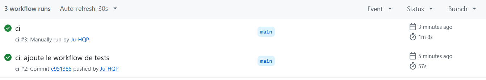
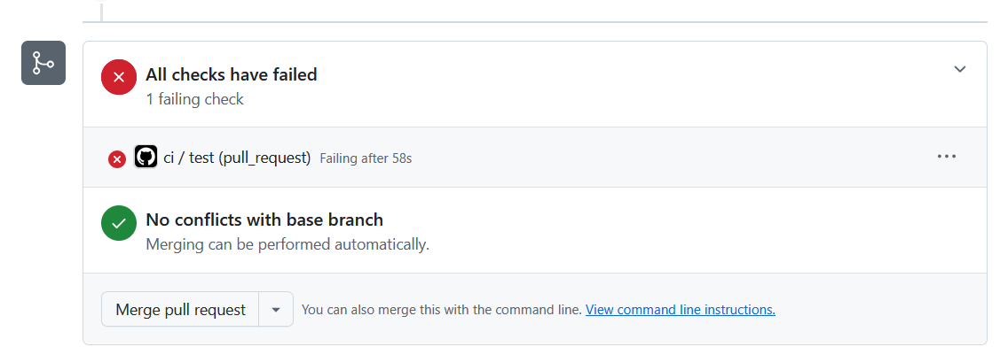

# Réponses au TP

## Jalon 1
- git clone https://github.com/Ju-HQP/shipit-starter.git
- npm ci
- npm test -> affiche Tests 5 passed

## Jalon 2

Création du fichier ci-yml et rédaction de la config.

## Jalon 3

- git add *
- git commit -m "ci: ajoute le workflow de tests "
- git push

## Jalon 4

Question 4 Prédiction : le workflow ne va pas marcher car l'instruction testé
expect(res.statusCode).toBe(201); recevra le code 200 comme précédemment au lieu d'être 201

Question 5 : Le pull request a rencontré une erreur à cause des test pas passés. Car le workflow se bloque pour le test de code de statut 200
Error: AssertionError: expected 200 to be 201 // Object.is equality